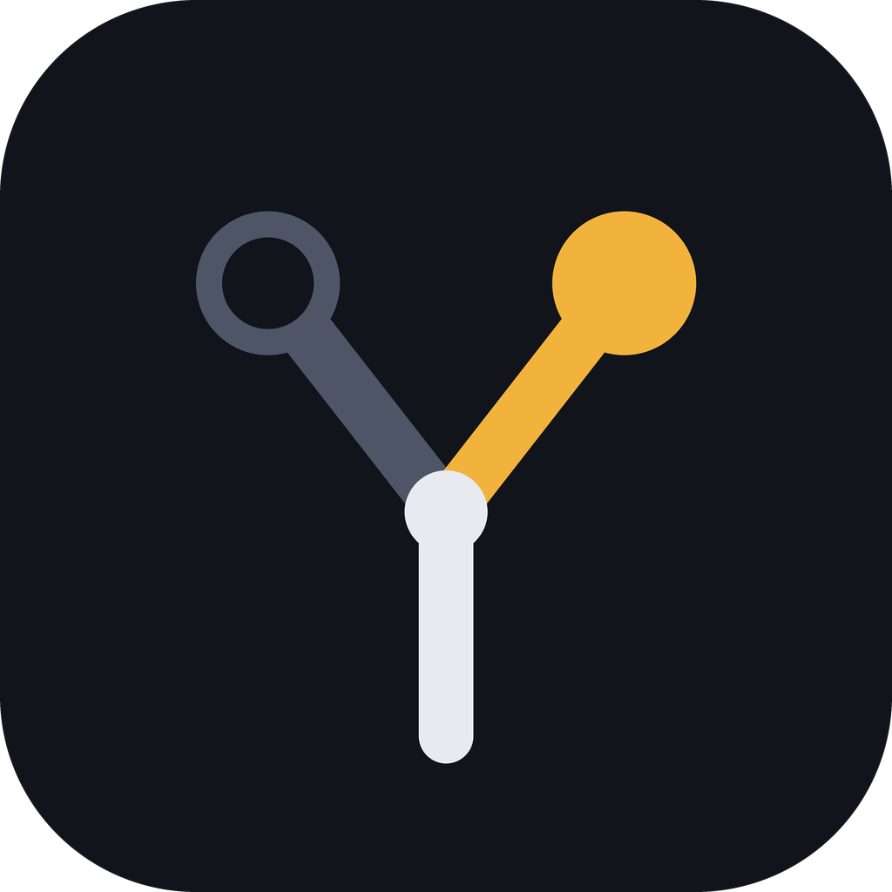

# You Decide — a human-gated development method for Claude Code

**You decide. Claude ships.** · [Version française plus bas](#version-française)

You Decide is a plugin that pushes automation as far as it can go while keeping every strategic decision with a human.
Claude researches, plans, writes the tests first, implements, gets reviewed by an independent agent, fixes what the
review finds and commits locally. You choose the architecture, the dependencies, the trade-offs and anything that
cannot be undone.

It was extracted from the method I use to build a privacy-protection platform on my own with Claude Code (Rust and
TypeScript, under EU law). It depends on no language, no domain and no country: you set your jurisdictions at setup.

## Install

In a Claude Code session:

```
/plugin marketplace add guillaume-piron-dev/you-decide
/plugin install you-decide@you-decide
```

On Claude Code 2.1.275 or later, one command does both: `/plugin install you-decide --marketplace guillaume-piron-dev/you-decide`.

Then, in your project, run `/you-decide:setup`. It detects your stack, asks a few multiple-choice questions and shows
you a plan. It writes nothing before you approve.

## The daily loop

| When | Command | What happens |
|---|---|---|
| Start or resume | `/you-decide:session` | Reads one state file (under 10k tokens), logs your request in your own words, proposes a plan before any code |
| Before a costly choice | `/you-decide:decide` | Researches the options, screens each dependency or service, asks you to choose, writes a decision record |
| Implement | `/you-decide:story-to-tests` | One test per acceptance criterion and edge case, proven to fail, then the smallest code that passes |
| After each multiple-choice answer | `/you-decide:memory` | Records the question, its options and your answer word for word; at each step end it moves closed rows to volumes, refreshes the reference map and guards the logs against loss |
| Before the commit | `/you-decide:review` | An independent reviewer subagent reads the diff only; every finding is fixed in the flow |
| Finish | `/you-decide:close-step` | Local CI green, findings closed, state updated, local commit. Never a push without your "yes" |
| End of a phase | `/you-decide:milestone` | Full re-verification, comparison with the best, measured baselines, clean hand-off |

Two more skills are used when needed: `log` (append-only logs of your requests, review findings and deferred items)
and `compliance` (legal or regulatory questions: sources first, a stand-alone question for an expert, never legal
advice).

## Three levels, because not every project needs everything

| Level | For | What it adds |
|---|---|---|
| Light | prototype, script, experiment | `CLAUDE.md` + `docs/state.md` |
| Standard | a product in progress | + plan, requests log, findings log, decision records, project memory (answers word for word, map, loss guard, volumes) |
| Strict | regulated, sensitive or critical work | + AI usage log, traceability matrix, compliance question file, transcript backups |

## Adapt it to your country

`setup` asks where you, your users, your data and your hosting are, and writes those jurisdictions into your
`CLAUDE.md`. The `compliance` and `decide` skills then work from them, with a list of official legislation sites and
regulators for the EU, France, the UK, Switzerland, the US, Canada, Brazil, Japan, South Korea, China, India,
Singapore, Australia, New Zealand, South Africa, Nigeria and Kenya, plus international standards
([skills/compliance/references/regions.md](skills/compliance/references/regions.md)). The same file lists the
references I use myself for the EU and France. Claude answers in your language; the plugin files are in English.

## Where it works

| | claude.ai chat | Cowork | Claude Code |
|---|---|---|---|
| The 10 skills | ✓ | ✓ | ✓ |
| `reviewer` subagent | — | ✓ | ✓ |
| Hooks (guardrails, state re-injection) | — | ✓ | ✓ |

## What this plugin runs, changes and sends

- **Sends nothing.** No network call, no telemetry, no package download. Web searches happen only when a skill asks
  Claude to research, through Claude's own tools and your permission settings.
- **Hooks** (`hooks/`: standard-library Python behind three small shell launchers, covered by tests in `tests/`) run
  locally on each shell command and file write, before a compaction, and after a compaction or `/clear`:
  - before a shell command (Bash or PowerShell), they ask for your "yes" before `git push`, history rewrites,
    discarding local changes, recursive deletions, destructive SQL, migration rollbacks, package publishing,
    data-sending network calls (calls to `localhost` are not interrupted), `curl | sh`, remote copies, cloud and
    infrastructure changes; they block the usual commands that would print a secret file (`cat`, `grep`,
    `Get-Content`… on `.env` or key files) and commands that contain a token;
  - before a file write, they block high-confidence secrets (private keys, cloud and API tokens) and ask for likely
    credentials, `.env` files and destructive SQL in migrations;
  - after a compaction or `/clear`, they re-inject `docs/state.md` (with project memory: also the open rows of the
    logs and the last answers, after appending any new answer to `docs/questions_answers.md`);
  - before a compaction, with project memory only, they append new answers to `docs/questions_answers.md` and run the
    transcript backup and the journal if you enabled them.
  `guard.py` names credential files (`.env`, `.git-credentials`, private keys…) and credential variables only to
  recognise and block commands that would print them: it never opens, reads or sends any of them. The tests in
  `tests/` use fake values, `example.org` addresses and variable names such as `API_KEY` only as inputs to the guard;
  they make no network call.
  They need Python 3.8 or later, found as `python3`, `py -3` or `python`. On Windows, Claude Code runs hooks through
  Git Bash (installed with Git for Windows); the Microsoft Store `python3` shortcut is detected and skipped. They are
  pattern-based: they catch the usual commands and token formats, not every possible one.
- **Project memory** (standard and strict levels; `skills/memory/scripts/yd_memory.py`, standard-library Python,
  covered by `tests/test_memory.py`): it reads this project's Claude Code transcripts on your machine to record your
  answers to multiple-choice questions, and writes only under `docs/` (answers, map, volumes, conservation register).
  Only if you enable them in `docs/memory/config.json`, it also writes outside the repository: a gzip backup of the
  transcript before each compaction (`~/.you-decide/transcripts/<project>/`, run by the `PreCompact` hook), a private
  journal of your messages (`~/.you-decide/journal/<project>.md`). It can also prepare documents for you to upload to a
  claude.ai Project, in `.you-decide/project_sync/` inside the project, and refuses to do so until that folder is
  ignored by git. Without `docs/memory/config.json`, the memory hooks do nothing.
- **`setup` changes your project only after you approve its plan**: it writes `CLAUDE.md`, files under `docs/`, and
  permission rules in `.claude/settings.json` (merged with yours; it never loosens a `deny` rule).
- **The other skills** write only the project files they name (state, logs, decision records) and make local commits.
  None of them pushes, publishes or deletes without your explicit "yes".

**The hooks and permission rules are guardrails, not a security guarantee.** Keep secrets out of the project folder.

## Cost

About 1,020 tokens are added to every session (skill and agent descriptions), as measured by `claude plugin details`.
A skill's full text loads only when it runs.

## Limits

- It does not replace stack-specific skills (React, Rust, Django…). Combine them.
- The `compliance` skill prepares sourced questions for a lawyer or regulator. It never gives legal advice, and its
  list of official sources is a starting point to check, not a legal reference.
- Tested on Linux and on Windows 11 (Git Bash, Python 3.13). Not yet tested on macOS: please report what breaks.
- It is opinionated: one session = one task, plan before code, findings fixed in the flow. If that is not how you
  want to work, it is not for you.

## Develop and test

```
python3 -m unittest discover -s tests -v
claude plugin validate . --strict
claude --plugin-dir .
```

## License and privacy

Apache-2.0. The plugin collects and sends nothing: see [PRIVACY.md](PRIVACY.md). Issues and pull requests are
welcome.

---

## Version française

**Tu décides. Claude exécute.**

You Decide est un plugin Claude Code qui pousse l'automatisation au maximum tout en laissant chaque décision
stratégique à un humain. Claude cherche, planifie, écrit les tests d'abord, implémente, se fait relire par un agent
indépendant, corrige ce que la relecture trouve et commite en local. Toi, tu choisis l'architecture, les dépendances,
les compromis et tout ce qui est irréversible.

Il est tiré de la méthode que j'utilise pour développer seul, avec Claude Code, une plateforme de protection de la vie
privée (Rust et TypeScript, droit européen). Il ne dépend d'aucun langage, d'aucun domaine ni d'aucun pays : tu
indiques tes juridictions au démarrage.

### Installation

```
/plugin marketplace add guillaume-piron-dev/you-decide
/plugin install you-decide@you-decide
```

Depuis Claude Code 2.1.275, une seule commande suffit : `/plugin install you-decide --marketplace guillaume-piron-dev/you-decide`.
Puis, dans ton projet : `/you-decide:setup`. La skill détecte ta stack, te pose quelques questions à choix et te
montre un plan. Elle n'écrit rien avant ton accord.

### La boucle de travail

| Moment | Commande | Ce qui se passe |
|---|---|---|
| Démarrer ou reprendre | `/you-decide:session` | Lit un seul fichier d'état, note ta demande avec tes mots, propose un plan avant le code |
| Avant un choix coûteux | `/you-decide:decide` | Recherche les options, passe chaque dépendance au crible, te fait choisir, écrit la décision |
| Implémenter | `/you-decide:story-to-tests` | Un test par critère d'acceptation et cas limite, puis le plus petit code qui passe |
| Après chaque réponse à une question à choix | `/you-decide:memory` | Note la question, ses options et ta réponse mot pour mot ; en fin d'étape, range les lignes closes en volumes, met à jour la carte des références et garde les journaux contre toute perte |
| Avant le commit | `/you-decide:review` | Un sous-agent relecteur indépendant lit le diff ; chaque constat est corrigé dans la foulée |
| Finir | `/you-decide:close-step` | CI locale verte, constats fermés, état à jour, commit local. Jamais de push sans ton « oui » |
| Fin de phase | `/you-decide:milestone` | Revérification complète, comparaison avec les meilleurs, mesures réelles, passation propre |

### Trois niveaux

Léger (prototype, script), standard (produit en cours, avec la mémoire du projet), exigeant (projet réglementé ou
sensible, avec la sauvegarde des transcriptions). Chacun n'installe que ce dont il a besoin.

### Adapté à ton pays

`setup` te demande où se trouvent toi, tes utilisateurs, tes données et ton hébergement, et l'écrit dans ton
`CLAUDE.md`. Les skills `compliance` et `decide` s'en servent, avec les sites officiels de législation et les autorités
de contrôle de 17 régions du monde et les normes internationales
([skills/compliance/references/regions.md](skills/compliance/references/regions.md)). Mes propres références (UE et
France) y figurent aussi. Claude te répond dans ta langue.

### Ce que le plugin exécute, modifie et envoie

Il n'envoie rien sur le réseau et ne télécharge rien. La mémoire du projet lit les transcriptions locales de Claude
Code pour noter tes réponses et n'écrit que sous `docs/` ; seulement si tu les actives, elle écrit hors du dépôt une
sauvegarde des transcriptions avant chaque compaction, un journal privé de tes messages et les documents à charger dans
un Projet claude.ai. Les hooks tournent en local : ils demandent ton accord avant un
push, une réécriture d'historique, une suppression récursive, du SQL destructif, une publication ou un envoi réseau (les
appels à `localhost` ne sont pas interrompus), bloquent les commandes courantes qui afficheraient un fichier secret et
l'écriture de secrets évidents, et réinjectent le fichier d'état après une compaction. `guard.py` ne cite les fichiers d'identifiants (`.env`, `.git-credentials`, clés privées…) que pour reconnaître et
bloquer les commandes qui les afficheraient : il ne les ouvre, ne les lit et ne les envoie jamais. Ils demandent
Python 3.8 ou plus ;
sous Windows, Claude Code les exécute via Git Bash. `setup` n'écrit dans ton projet (`CLAUDE.md`, `docs/`, règles de
permission de `.claude/settings.json`, fusionnées sans jamais assouplir un `deny`) qu'après ton accord sur son plan.
Ce sont des garde-fous, pas une garantie de sécurité : aucun secret ne doit se trouver dans le dossier du projet.

### Limites

Le kit ne remplace pas les skills propres à une stack. La skill `compliance` prépare des questions sourcées pour un
juriste ; elle ne donne jamais d'avis juridique, et sa liste de sources officielles est un point de départ à vérifier.
Testé sous Linux et Windows 11, pas encore sous macOS : signale ce qui casse.

Licence Apache-2.0. Confidentialité : le plugin ne collecte et n'envoie rien ([PRIVACY.md](PRIVACY.md)).
